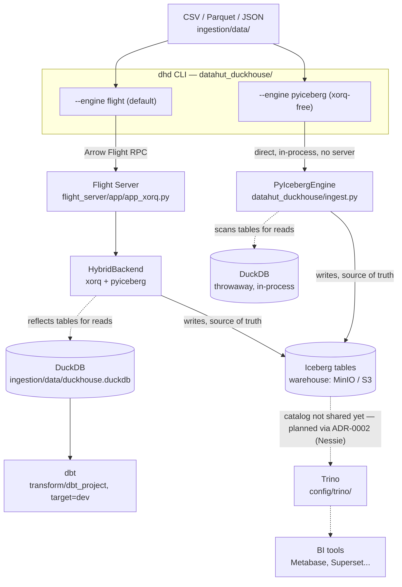

# 🏠 DataHut-DuckHouse

**DataHut-DuckHouse** is a lightweight, hybrid, and open-source analytics platform that combines the simplicity of **DuckDB**, the scalability of **Iceberg**, the speed of **Arrow Flight**, the orchestration power of **Xorq**, and the modularity of **dbt** to create a modern, local or cloud-ready data stack.

## 🧱 Architecture



Two independent ways to get data into Iceberg — the default `flight` engine goes
through the Arrow Flight server (`xorq` + `HybridBackend`); `--engine pyiceberg`
talks to the Iceberg catalog directly, no server, no `xorq` dependency. Both land
in the same MinIO/S3 warehouse. See [Engines](#engines---engine-flight-default-vs---engine-pyiceberg)
below. DuckDB is always a read-side reflection, never the source of truth
(ADR-0001). The Trino leg is scaffolded (`config/trino/`, `docker-compose.yml`)
but **not functional yet** — see [Known gaps](#-known-gaps) and
[ADR-0002](docs/adr/0002-iceberg-catalog-nessie.md).

## ✨ Features

- 🔗 Fast ingestion via Arrow Flight, or serverless straight to Iceberg (`--engine pyiceberg`)
- 🐤 Hybrid storage: Iceberg is the source of truth, DuckDB reflects it for reads
- 🧠 Orchestration with Xorq (Flight + multi-backend support)
- ☁️ S3 integration via MinIO
- 📊 Declarative SQL transformations using dbt (DuckDB `dev` target)
- 🔜 Trino for distributed SQL over Iceberg — scaffolded, not wired yet (needs a shared catalog, ADR-0002)
- 🔜 Multi-tenancy — deliberately deferred until there's a second real user (see [docs/ROADMAP.md](docs/ROADMAP.md))

## ⚙️ Requirements

- [Python 3.11 or 3.12](https://www.python.org/downloads/) (uv can install it for you)
- [uv](https://docs.astral.sh/uv/) — dependency & environment manager
- [Docker](https://www.docker.com/) with the Compose plugin

## 🚀 Installation

### 1. Clone the repository

```bash
git clone https://github.com/Geobatpo07/datahut-duckhouse.git
cd datahut-duckhouse
```

### 2. Install Python dependencies

```bash
uv sync          # creates .venv from uv.lock
```

Run any command inside the environment with `uv run <cmd>` (e.g. `uv run pytest`).

### 3. Configure the environment

```bash
make env         # copies .devcontainer/.env.example -> .env
# then edit .env and set MINIO_ROOT_PASSWORD / AWS_SECRET_ACCESS_KEY
```

`.env` is git-ignored and is the only place secrets live — the Dockerfiles and
`docker-compose.yml` contain none.

> ⚠️ `config/trino/etc/catalog/iceberg.properties` hardcodes the MinIO credentials
> as `minioadmin` / `minioadmin123`. Until that's parameterized, set
> `MINIO_ROOT_PASSWORD` and `AWS_SECRET_ACCESS_KEY` to `minioadmin123` — anything
> else and Trino/MinIO end up with mismatched credentials.

### 4. Launch the full environment

```bash
docker compose up --build      # or: make docker-up
```

Docker build files live in [`.devcontainer/`](.devcontainer/); `docker-compose.yml`
stays at the repo root. VS Code users can also "Reopen in Container" — the
[`.devcontainer/devcontainer.json`](.devcontainer/devcontainer.json) brings up the
same stack as a dev environment.

`minio`, `minio-setup`, `flight-server` and `xorq-admin` build and come up
clean (verified 2026-11-08: full `--build` from a cold image cache took ~4
minutes; `minio`, `xorq-service` and `flight-server` report healthy within
~15s of starting, `xorq-admin` within ~30s). `trino` does not — see
[Known gaps](#-known-gaps) and the [Docker quick start](#-démarrage-rapide-docker)
below for the exact error.

### 5. Ingest and query with the `dhd` CLI

`dhd` is the single-user client (roadmap Phase 2). By default it drives the Flight
server — start one first (`make dev-server`, or
`uv run python -m flight_server.app.app_xorq`), then in another shell:

```bash
uv run dhd create-table sales data/sales.csv      # .csv / .parquet / .json
uv run dhd list-tables
uv run dhd insert sales data/sales_new.csv          # --mode append|overwrite
uv run dhd query "SELECT * FROM sales"
```

`dhd` reads `FLIGHT_SERVER_HOST` / `FLIGHT_SERVER_PORT` (default `localhost:8815`).
If the server isn't running it fails with a clear message rather than hanging.
`dhd branch …` is a placeholder until Nessie lands (ADR-0002 / Phase 3).

> ⚠️ **Against a real (Dockerized) Flight server + MinIO, `dhd create-table` and
> `dhd query` on the default `flight` engine currently segfault** — see
> [Démarrage rapide (Docker)](#-démarrage-rapide-docker) below for the exact
> reproduction and the working alternative (`--engine pyiceberg`).

#### 🐳 Démarrage rapide (Docker)

Verified end to end on 2026-11-08, Docker Desktop 29.6.2 / Compose v5.3.1, against
a cold image cache:

```bash
cp .devcontainer/.env.example .env   # or: make env — then edit MINIO_ROOT_PASSWORD etc.
docker compose up --build -d
docker compose ps                    # minio, xorq-service, flight-server, xorq-admin -> healthy; trino crash-loops, see below
```

With the stack up, the full CLI round trip against the real containers
(`localhost:8815` Flight server, `localhost:9000` MinIO S3):

```bash
uv run dhd list-tables                                    # OK
uv run dhd insert sales data/sales_new.csv --mode append  # OK (table already existed from a prior run here)
uv run dhd create-table sales data/sales.csv              # Segmentation fault (exit 139)
uv run dhd query "SELECT * FROM sales"                    # Segmentation fault (exit 139), 100% reproducible
```

This is the **same bug class** previously documented for xorq 0.2.4
(cloudpickling an ibis `Schema` in a Flight action response) — but it still
reproduces on xorq 0.4.11 against a real Dockerized Flight server + real MinIO,
even though the fix had been verified under a local `moto` S3 mock in a
previous pass (see the correction below). Any action that round-trips a
table's `Schema` (`create-table`'s confirmation step, `query`) crashes the
`dhd` client process outright (`Windows fatal exception: access violation` /
SIGSEGV); `list-tables` and `insert` do not and work fine.

**Root cause found and verified (2026-11-08, `fix/segfault-diagnosis`):** it's
a client/server **Python minor-version mismatch**, not MinIO, not Docker
networking, and not an xorq-version regression. `cloudpickle`'s
reconstruction of xorq's vendored `ibis` `Schema`/`Annotable` class breaks
across a Python minor-version boundary — this host's dev venv resolved to
Python 3.12.7 (`pyproject.toml`'s `requires-python = ">=3.11,<3.13"` is a
*range*), while `.devcontainer/flight-server.Dockerfile` pins the image to
Python 3.11. Verified in both directions: a Python-3.11 client (either from
inside the container, or from a separate `uv venv --python 3.11` on this same
Windows host) never crashes against the exact same Docker + MinIO server; a
Python-3.12 client crashes 100% of the time. Full mechanism, the minimal
reproducer (`scripts/repro_segfault.py`), and the draft upstream issue are in
[ADR-0001](docs/adr/0001-canonical-hybrid-backend.md#segfault-root-cause-2026-11-08-fixsegfault-diagnosis)
and [`docs/UPSTREAM_ISSUE.md`](docs/UPSTREAM_ISSUE.md).
`tests/test_python_version_matches_flight_image.py` guards against this
regressing silently again (currently **fails on this dev machine** — Python
3.12 vs. the image's pinned 3.11 — by design, until one side is repinned; see
that test's docstring for the exact fix recipe).

**The working path against Docker today is `--engine pyiceberg`**, verified
for the full round trip:

```bash
ICEBERG_WAREHOUSE=s3://duckhouse-warehouse/ S3_ENDPOINT=http://localhost:9000 \
AWS_ACCESS_KEY_ID=minioadmin AWS_SECRET_ACCESS_KEY=minioadmin123 \
  uv run dhd --engine pyiceberg create-table sales data/sales.csv   # OK
  uv run dhd --engine pyiceberg insert sales data/sales_new.csv --mode append  # OK
  uv run dhd --engine pyiceberg query "SELECT * FROM sales"         # OK
  uv run dhd --engine pyiceberg list-tables                         # OK
```

**`trino` does not start.** It crash-loops (`restart: unless-stopped` keeps
retrying every ~15-20s): Trino 483 rejects the catalog config in
`config/trino/etc/catalog/iceberg.properties` with **41 configuration
errors** — `iceberg.catalog.type=hadoop` isn't a valid `CatalogType` anymore,
every `hive.s3.*` / `fs.s3a.*` property is unused on this version, and several
`iceberg.*` keys were renamed (e.g. `iceberg.target-file-size-bytes` →
`iceberg.target-max-file-size`). Exact first lines of the error:

```
io.airlift.bootstrap.ApplicationConfigurationException: Configuration errors:
1) Error: Invalid value 'hadoop' for type CatalogType (property 'iceberg.catalog.type') ...
2) Error: Defunct property 'iceberg.extended-statistics.enabled' (class [class IcebergConfig]) cannot be configured.
...
41 errors
```

Rewriting this file for Trino 483 would still not make it useful today: Trino
and the Flight server's `pyiceberg` catalog don't share a catalog (that's
[ADR-0002](docs/adr/0002-iceberg-catalog-nessie.md)'s Nessie work, not done
yet), so fixing the properties alone wouldn't let Trino see tables `dhd`
writes. Left as-is for this pass — see [Known gaps](#-known-gaps).

Also found and fixed while verifying this: `flight-server` originally
crash-looped too (`psycopg` has no system `libpq` in the slim runtime image —
switched to `psycopg[binary]`), and `xorq-admin` reported permanently
"unhealthy" despite serving traffic (its healthcheck hit `localhost`, which
resolves to `::1` first, and nginx only listens on IPv4 — pointed it at
`127.0.0.1`). Both are fixed in this repo's Dockerfiles already.

**Correction to the previous pass's segfault write-up:** the "Verified round
trip without Docker" section below claims the xorq 0.2.4 → 0.4.11 upgrade
fixed the historical segfault, verified against a local `moto` S3 mock. That
verification was real, but incomplete — it does **not** reproduce the actual
failure condition. Against a real Dockerized Flight server + real MinIO, the
segfault is still 100% reproducible on xorq 0.4.11, as shown above. Treat the
`moto`-based claim below as disproven for the Docker/real-S3 case; `--engine
pyiceberg` is the only verified-working path against Docker today.

#### Verified round trip without Docker

The commands above were run and verified as two separate processes (not Docker,
not in-process tests) against a local filesystem warehouse — no MinIO/S3
required:

```bash
# shell 1 — start the server against a local warehouse instead of MinIO
ICEBERG_WAREHOUSE= \
ICEBERG_WAREHOUSE_PATH=/tmp/dhd_demo/warehouse \
DUCKDB_PATH=/tmp/dhd_demo/duckhouse.duckdb \
  uv run python -m flight_server.app.app_xorq

# shell 2
uv run dhd create-table sales data/sales.csv
uv run dhd list-tables
uv run dhd insert sales data/sales_new.csv --mode append
uv run dhd query "SELECT * FROM sales"
```

`ICEBERG_WAREHOUSE=` (empty) is required if you have a `.env` with
`ICEBERG_WAREHOUSE=s3://…` set — `python-dotenv` won't override a variable
already present in the environment, so an explicit empty value is how you
force the local-path fallback. This confirms the Flight write/read loop
(`create-table` → `insert` → `query` → `list-tables`) end to end without
Docker. The full `docker-compose up` stack (MinIO + Trino + the containers)
was **not** re-verified in this pass — the Docker daemon wasn't reachable in
this environment; see step 4 above for what is and isn't expected to work
there.

The same round trip was also re-run with an `s3://` warehouse against a local
`moto` S3 mock (`uv run moto_server`, same separate-process setup), and did
**not** reproduce the historical segfault there. **This turned out to be an
incomplete test, not a fix:** against a real Dockerized Flight server + real
MinIO (verified 2026-11-08, see
[Démarrage rapide (Docker)](#-démarrage-rapide-docker)), the same segfault is
100% reproducible on xorq 0.4.11. Whatever `moto` mocks differs from real S3
in a way that avoids the crash; don't trust the `moto` result as evidence the
bug is fixed.

#### Engines: `--engine flight` (default) vs `--engine pyiceberg`

`dhd --engine pyiceberg <cmd>` (or `DHD_ENGINE=pyiceberg`) skips the Flight
server entirely and talks straight to the Iceberg catalog with `pyiceberg` +
`pyarrow` — no server to start, no `xorq` in the path. Reads run through a
throwaway in-process DuckDB that scans the Iceberg tables.

```bash
# local file:// warehouse (default when ICEBERG_WAREHOUSE is unset)
uv run dhd --engine pyiceberg create-table sales data/sales.csv
uv run dhd --engine pyiceberg query "SELECT count(*) FROM sales"

# against MinIO / S3
ICEBERG_WAREHOUSE=s3://duckhouse-warehouse/ \
S3_ENDPOINT=http://localhost:9000 \
AWS_ACCESS_KEY_ID=minioadmin AWS_SECRET_ACCESS_KEY=minioadmin123 \
  uv run dhd --engine pyiceberg create-table sales data/sales.csv
```

It keeps its own SQL catalog file (`ingestion/data/pyiceberg_catalog.db`),
separate from a running Flight server's catalog — fine for the single-user model
(ADR-0001); a shared catalog arrives with Nessie (ADR-0002 / Phase 3). The CLI
does not read `.env` itself, so pass `ICEBERG_*` / `S3_*` / `AWS_*` in the
environment.

## 🪟 Commandes sans make

`make` n'est pas installé sur cette machine (Windows, Git Bash sans `make` sur
le `PATH`). Les commandes ci-dessous sont les équivalents exacts de chaque
cible utile du `Makefile`, vérifiés sur cette machine ; elles sont toutes de
simples alias `uv run …` / `docker compose …` que `make` appelle déjà, donc
aucune n'a demandé de nouvel outil de tâches.

| Cible `make`  | Équivalent vérifié |
|---------------|---------------------|
| `make sync`   | `uv sync --frozen` |
| `make test`   | `uv run pytest --cov=flight_server --cov=scripts --cov=datahut_duckhouse --cov-report=term-missing` |
| `make lint`   | `uv run ruff check .` puis `uv run black --check .` puis `uv run mypy flight_server scripts datahut_duckhouse` |
| `make format` | `uv run ruff check . --fix` puis `uv run black .` |
| `make docker-up` | `docker compose up -d` (après `cp .devcontainer/.env.example .env` si `.env` n'existe pas encore — c'est ce que fait la dépendance `env` de cette cible) |
| `make docker-down` | `docker compose down` |
| `make docker-logs` | `docker compose logs -f` |

Toutes les autres cibles du `Makefile` (`docker-build`, `docker-restart`,
`create-tenant`, `dbt-run-dev`, `query-trino-list`, etc.) sont aussi de
simples alias `$(UV) run …` / `$(COMPOSE) …` — il suffit de lire la ligne
correspondante dans le [`Makefile`](Makefile) et de lancer la commande qu'elle
appelle directement ; aucune n'a d'équivalent qui ne soit pas déjà un simple
alias.

## 📂 Project Structure

```
datahut-duckhouse/
├── datahut_duckhouse/    # `dhd` CLI (the only packaged component)
│   ├── cli.py            # click commands, --engine flight|pyiceberg
│   ├── connection.py     # flight engine: connects to the Flight server
│   ├── ingest.py         # pyiceberg engine: talks to Iceberg directly, no xorq
│   └── ingest_dlt.py     # `dhd ingest-dlt`: loads dlt-extracted sources into Iceberg
├── flight_server/        # Arrow Flight Server + HybridBackend
│   └── app/
│       ├── app_xorq.py
│       ├── xorq_config.py
│       ├── utils.py
│       ├── trino_client.py
│       ├── monitoring.py
│       └── backends/hybrid_backend.py
├── orchestrator/         # standalone FastAPI orchestration API (xorq-service)
├── xorq-admin-dashboard/ # React/Vite admin UI, served by nginx (xorq-admin)
├── ingestion/
│   ├── data/             # Source CSV + local duckhouse.duckdb
│   └── dlt/              # multi-engine extraction (Vague 1, extra `ingest`)
│       ├── sources.yml   # one entry per source DB
│       └── pipeline.py   # reads sources.yml, extracts via dlt to Parquet
├── scripts/              # Ingestion, queries, tenant management, dbt runner
│   ├── ingest_flight.py
│   ├── query_duckdb.py
│   ├── query_trino.py
│   ├── setup_iceberg_tables.py
│   ├── create_tenant.py
│   ├── delete_tenant.py
│   ├── fetch_chinook.py  # downloads the Chinook SQLite fixture on demand
│   ├── demo.py           # one-command multi-engine demo (Vague 1)
│   ├── bench_writes.py   # Iceberg write/commit cost benchmark (Vague 1)
│   ├── repro_segfault.py # minimal segfault reproducer (fix/segfault-diagnosis)
│   └── smoke_test.py     # Docker round-trip smoke test (CI: integration.yml)
├── query_engine/         # unified DuckDB/Trino query-routing prototype
├── transform/dbt_project/ # dbt models (config/profiles.yml, target=dev|prod)
├── config/               # Trino + tenants config
│   ├── trino/etc/
│   └── tenants/tenants.yml
├── tests/                # pytest suite (unit + in-process Flight e2e)
│   ├── integration/      # -m integration: real Postgres/MySQL/SQLite (Vague 1)
│   └── docker/chinook/   # vendored Chinook load scripts (pinned commit)
├── docs/
│   ├── adr/              # Architecture Decision Records (0001–0005)
│   ├── ROADMAP.md        # phased plan, single source of truth on status
│   ├── DOGFOOD.md        # Vague 1: measured numbers, frictions, open questions
│   ├── THIRD_PARTY_CHINOOK.md  # Chinook dataset license + pinned commit
│   └── UPSTREAM_ISSUE.md # draft xorq issue: segfault root cause (not posted)
├── docker-compose.test.yml  # Postgres/MySQL/(optional SQL Server) Chinook fixtures
├── .devcontainer/        # Dockerfiles + devcontainer.json + .env.example
├── .env                  # Secrets & config (git-ignored; from .devcontainer/.env.example)
├── docker-compose.yml    # Stack definition (root; no secrets)
├── uv.lock
└── pyproject.toml
```

## 🧠 Using dbt with DuckDB

```bash
cd transform/dbt_project
uv run dbt deps                                    # installs dbt_utils (packages.yml)
uv run dbt run  --profiles-dir config --target dev
uv run dbt test --profiles-dir config --target dev  # a few tests still fail, see Known gaps
```

## 🔎 Example Local Query

```bash
uv run python scripts/query_duckdb.py
```

## 🧪 Banc d'essai multi-moteurs (Vague 1)

Preuve que la même base (Chinook, base de démonstration d'une boutique de
musique) s'ingère correctement depuis plusieurs moteurs SQL avec
[dlt](https://dlthub.com/), et mesure du coût des écritures Iceberg. Les
données AYITISTATS ne sont pas encore branchées — c'est la suite prévue, une
fois ce harnais vérifié sur un jeu de données neutre.

### Moteurs vérifiés / non vérifiés

| Moteur | Statut |
|---|---|
| SQLite | ✅ Vérifié — démo en une commande, aucun Docker requis |
| PostgreSQL | ✅ Vérifié — `docker-compose.test.yml`, 10/10 tests d'intégration passent |
| MySQL | ✅ Vérifié — `docker-compose.test.yml`, 10/10 tests d'intégration passent |
| SQL Server | ⚠️ **Non vérifié** — service scaffoldé derrière le profil compose optionnel `mssql` (image x86_64 uniquement, démarrage plus lourd), jamais démarré ni testé dans cette session. Voir [tests/docker/chinook/README.md](tests/docker/chinook/README.md). |

### Commandes exactes

```bash
# Dépendances dlt + pilotes (extra optionnel, pas dans les dépendances principales)
uv sync --extra ingest

# Démo en une commande, SQLite seul, aucun Docker requis
uv run python scripts/demo.py

# Variante avec Docker (Postgres + MySQL) :
docker compose -f docker-compose.test.yml up -d
uv run python scripts/demo.py --source pg_chinook
uv run python scripts/demo.py --source mysql_chinook

# Charger n'importe quelle source dans Iceberg (toujours --engine pyiceberg,
# voir Known gaps) :
uv run dhd ingest-dlt --source sqlite_chinook   # ou pg_chinook / mysql_chinook / all

# Tests d'intégration réels (besoin du stack Docker + du fichier SQLite) :
uv run python scripts/fetch_chinook.py
uv run pytest -m integration

# Coût des écritures Iceberg (local puis MinIO) :
uv run python scripts/bench_writes.py --sizes 100000 1000000 --minio
```

### Limites

Chinook est **petit** : ~15 000 lignes au total sur 11 tables. Ce banc
d'essai valide la **justesse** (mêmes lignes, mêmes types, même résultat de
jointure quel que soit le moteur source) et le **coût relatif par commit**
(mesuré avec un jeu synthétique de 100k/1M lignes, voir
[docs/DOGFOOD.md](docs/DOGFOOD.md)) — **pas** la performance à l'échelle
réelle, pas le comportement multi-writer, et pas SQL Server. Les chiffres
bruts, les frictions rencontrées, et les questions encore ouvertes sont
dans [docs/DOGFOOD.md](docs/DOGFOOD.md).

## 🏢 Multi-tenancy — planned, not provided

**Positioning:** DataHut-DuckHouse is a lightweight analytics engine meant to be
deployed per client, not a multi-tenant SaaS. Today, each deployment serves one
tenant.

Real multi-tenancy (isolated namespaces, per-tenant auth, quotas, billing) is
**planned** work, sequenced as roadmap [Phases 6–9](docs/ROADMAP.md) and specified
in [ADR-0003](docs/adr/0003-tenant-metadata-postgres.md),
[ADR-0004](docs/adr/0004-tenant-isolation-model.md) and
[ADR-0005](docs/adr/0005-authentication-authorization.md) — it is not implemented
yet. Concretely, as of this writing:

- Tenants are declared in [`config/tenants/tenants.yml`](config/tenants/tenants.yml),
  a static list with no enforcement behind it.
- `scripts/create_tenant.py` / `scripts/delete_tenant.py` are **not
  implemented** — they exit 1 with a message pointing here instead of
  pretending to work (they used to import a module that doesn't exist and
  crash with `ModuleNotFoundError`).
- `dhd` and `HybridBackend` have no tenant concept at all — every table lives in
  one shared namespace.
- The Flight server has **no authentication**: anyone who can reach the port can
  read and write every table.

## 📈 BI Interface with Trino

**Not functional yet.** `trino` currently fails to start — config in
`config/trino/etc/` predates Trino 483's config format (41 rejected
configuration properties; exact error in
[Démarrage rapide (Docker)](#-démarrage-rapide-docker)) — and even once it
starts, it has no catalog shared with the Iceberg tables `dhd`/`HybridBackend`
write — that needs [ADR-0002](docs/adr/0002-iceberg-catalog-nessie.md)
(Nessie). Treat `docker-compose.yml`'s `trino` service and
`scripts/query_trino.py` / `scripts/setup_iceberg_tables.py` as scaffolding
for that future work, not a working path today.

## ⚠️ Known gaps

- **Trino doesn't start** (41 rejected config properties on Trino 483), and
  has no catalog shared with the rest of the stack even when it does — see
  the BI section above and [Démarrage rapide (Docker)](#-démarrage-rapide-docker).
- **`dhd create-table` / `dhd query` segfault against a real Dockerized Flight
  server + real MinIO**, on xorq 0.4.11, 100% reproducible — see
  [Démarrage rapide (Docker)](#-démarrage-rapide-docker). Use `--engine
  pyiceberg` instead; it's the only verified-working path against Docker.
  **Root cause found (2026-11-08):** a client/server Python minor-version
  mismatch breaks `cloudpickle` across the Flight schema round trip — see the
  "Root cause found and verified" note above, [ADR-0001](docs/adr/0001-canonical-hybrid-backend.md#segfault-root-cause-2026-11-08-fixsegfault-diagnosis)
  and [`docs/UPSTREAM_ISSUE.md`](docs/UPSTREAM_ISSUE.md). Not fixed in this
  repo (the fragile part is upstream, in xorq's vendored `ibis` +
  `cloudpickle`); a documented mitigation exists (pin matching Python
  versions) but was not applied, since it would force recreating the dev
  `.venv` or rebuilding the Docker image.
- `tests/test_python_version_matches_flight_image.py` currently **fails on
  this dev machine** (host Python 3.12 vs. the flight-server image's pinned
  3.11) — intentional, see the test's docstring; it's the regression guard
  for the gap above, not a new unrelated breakage.
- `config/trino/etc/catalog/iceberg.properties` hardcodes MinIO credentials —
  see the warning in step 3 above.

Tracked in more detail in [docs/ROADMAP.md](docs/ROADMAP.md) and the ADRs under
[docs/adr/](docs/adr/).

## 🛣️ Roadmap

Status lives in [docs/ROADMAP.md](docs/ROADMAP.md) (revised at every phase
change) plus the decisions in [docs/adr/](docs/adr/). Short version: the project
is deliberately building a solid single-user engine first (Iceberg-as-source-of-
truth, a working Flight loop, a dogfoodable CLI) before any multi-tenant/SaaS
work — see the roadmap's explicit bascule trigger for when that starts.

## 📄 License

Project under MIT License.

## ✍️ Author

Geovany Batista Polo LAGUERRE – [lgeobatpo98@gmail.com](mailto:lgeobatpo98@gmail.com) | Data Science & Analytics Engineer
